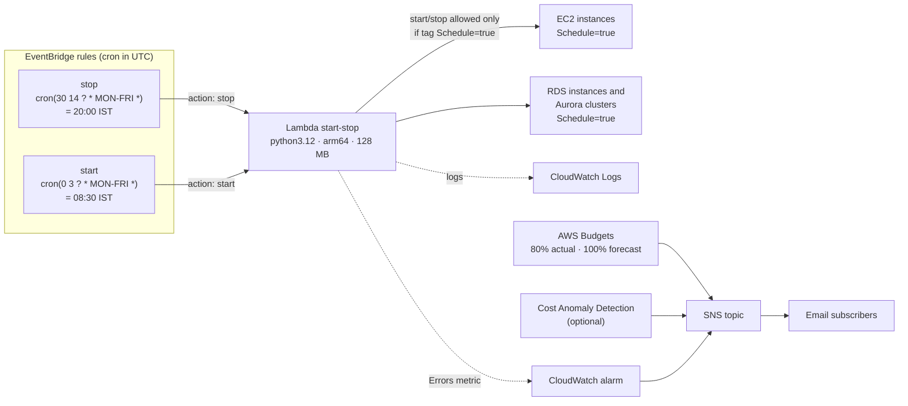

# cost-optimisation-terraform

[](https://github.com/18-ashish-sharma/cost-optimisation-terraform/actions/workflows/terraform.yml)


Terraform for two everyday AWS cost controls:

1. **Scheduled stop/start** of non-production EC2 instances and RDS databases that carry the
   tag `Schedule=true`, using EventBridge rules and one small Lambda function.
2. **Budget alerts**: a monthly AWS Budget (80 % actual, 100 % forecast) and an optional Cost
   Anomaly Detection monitor, delivered by SNS to email. Scheduler failures go to the same topic.

## Architecture



## Repository layout

```text
deploy/                     root module: one state per Terraform workspace (dev, staging, ...)
  backend.tf                S3 backend, partial config (values supplied at init)
  backend.hcl.example       bucket / key / region / use_lockfile
  example.tfvars            example inputs (copy to <env>.tfvars, which is git-ignored)
modules/
  scheduler/                Lambda + IAM + EventBridge rules + error alarm
    src/lambda_function.py  the start/stop logic
  budget-alerts/            AWS Budget + SNS topic + optional anomaly monitor
tests/                      pytest suite for the Lambda (moto, no AWS account needed)
.github/workflows/          fmt, validate, tflint, checkov, ruff, pytest (no credentials, no apply)
```

## What it optimises, and how

This section describes exactly what the code does.

### Scheduled stop/start (`modules/scheduler`)

| Step | Behaviour |
| ---- | --------- |
| Trigger | Each entry in `var.schedules` creates one EventBridge rule. The rule sends `{"action": "start"}` or `{"action": "stop"}` to the Lambda. |
| Selection, EC2 | `DescribeInstances` (paginated), filtered by tag and by state: **stop** picks `running`, **start** picks `stopped`. Instances with the `aws:autoscaling:groupName` tag are skipped. |
| Selection, RDS | `DescribeDBInstances` and `DescribeDBClusters` (paginated), matched on `TagList`. **stop** picks `available`, **start** picks `stopped`. Aurora members are handled at cluster level (`Start/StopDBCluster`), not per instance. |
| Action | `StartInstances`/`StopInstances` in batches of 50; `Start/StopDBInstance`; `Start/StopDBCluster`. |
| Idempotency | Only resources in the opposite state are selected, so running the same action twice is a no-op. |
| Failure | Every target is attempted. If any call fails, the function **raises** at the end, the invocation counts as an error, and the `Errors` alarm notifies the SNS topic. |
| Dry run | `{"action": "stop", "dry_run": true}` returns what would change and changes nothing. |
| Logs | One JSON line per action plus a summary line per run, kept for `log_retention_in_days` (default 14). |

### Budget alerts (`modules/budget-alerts`)

| Resource | Behaviour |
| -------- | --------- |
| `aws_budgets_budget` | Monthly `COST` budget for the whole account. One notification per item in `thresholds` (default: 80 % `ACTUAL`, 100 % `FORECASTED`). |
| `aws_sns_topic` + policy | Receives the alerts. Only `budgets`, `costalerts` and `cloudwatch` may publish, and only for this account. |
| `aws_sns_topic_subscription` | One email subscription per `alert_emails` entry (each address must confirm). |
| `aws_ce_anomaly_monitor` / `_subscription` | Optional (`enable_anomaly_detection`). Per-service monitor; alerts when an anomaly's total impact is at least `anomaly_threshold_amount` USD. |

Budgets and anomaly detection **report**; they do not stop or change anything.

### Estimating the saving (arithmetic, not a measured result)

With the default schedule a tagged resource runs 08:30–20:00 IST on weekdays:

* running hours per week = 11.5 h × 5 days = **57.5 h** out of 168 h
* stopped hours = 168 − 57.5 = 110.5 h, about **66 % fewer compute hours**

What that is worth depends on the resource. While stopped:

* EC2 on-demand **compute** is not billed, but **EBS volumes, snapshots and Elastic IPs still are**.
* RDS **instance hours** are not billed, but **storage, provisioned IOPS and backups still are**.
* Usage already covered by a Savings Plan or Reserved Instance is paid for either way; stopping
  it saves nothing unless the commitment is resized.

To measure the real effect, activate `Schedule` and `Environment` as cost allocation tags and
compare comparable weeks before and after in Cost Explorer (group by tag, filter EC2/RDS usage
types), or query the Cost and Usage Report by `line_item_usage_type` for those resources.

## Tagging contract

| Tag | Value | Effect |
| --- | ----- | ------ |
| `Schedule` | `true` | Resource is stopped and started on the schedule. Any other value, or no tag, is ignored. |

* Key and value are configurable (`schedule_tag_key`, `schedule_tag_value`). The IAM condition
  uses the same values, so the Lambda **cannot** stop an untagged resource even if the code
  had a bug.
* Do **not** tag instances owned by an Auto Scaling group, EKS managed node group or Karpenter:
  the group would replace them. Scale those to zero instead (for example ASG scheduled actions).
  The Lambda skips ASG members as a guard.
* For Aurora tag the **cluster**; for standalone RDS tag the **instance**.

## Usage

Requirements: Terraform ≥ 1.10, AWS credentials for the target account, an S3 bucket for state.

```bash
cd deploy

# 1. Backend: copy and fill in, then init (state in S3, locked by an S3 lock file)
cp backend.hcl.example backend.hcl
terraform init -backend-config=backend.hcl

# 2. Workspace = environment. Each workspace has its own state object:
#    s3://<bucket>/env:/<workspace>/<key>
terraform workspace new dev        # first time only
terraform workspace select dev

# 3. Inputs (*.tfvars is git-ignored)
cp example.tfvars dev.tfvars       # edit the budget amount and alert emails

# 4. Plan and apply
terraform plan  -var-file=dev.tfvars -out=dev.tfplan
terraform apply dev.tfplan
```

Resource names include the workspace (`cost-opt-dev-start-stop`, `cost-opt-dev-monthly`, ...)
and `default_tags` sets `Environment = <workspace>`, so two workspaces never collide.
Do not use the `default` workspace for a real environment.

### Run the Lambda by hand

```bash
FN=$(terraform output -raw scheduler_function_name)

# What would be stopped? Changes nothing.
aws lambda invoke --function-name "$FN" \
  --cli-binary-format raw-in-base64-out \
  --payload '{"action":"stop","dry_run":true}' out.json && cat out.json

# Really stop (or "start")
aws lambda invoke --function-name "$FN" --cli-binary-format raw-in-base64-out \
  --payload '{"action":"stop"}' out.json

# Follow the logs
aws logs tail "$(terraform output -raw scheduler_log_group)" --follow
```

A failed run returns `"FunctionError": "Unhandled"` from `invoke` and increments the `Errors`
metric that the alarm watches.

### Change the schedule

EventBridge rule cron expressions are in **UTC**. IST is UTC + 5:30 with no daylight saving, so
a fixed offset is safe. Format: `cron(minutes hours day-of-month month day-of-week year)`; one
of day-of-month / day-of-week must be `?`.

| Wanted (IST) | Expression (UTC) |
| ------------ | ---------------- |
| 20:00 Mon–Fri | `cron(30 14 ? * MON-FRI *)` |
| 08:30 Mon–Fri | `cron(0 3 ? * MON-FRI *)` |
| 22:00 every day | `cron(30 16 * * ? *)` |
| 09:00 Mon–Sat | `cron(30 3 ? * MON-SAT *)` |

## Testing

```bash
python3.12 -m venv .venv && . .venv/bin/activate
pip install -r requirements-dev.txt
ruff check . && ruff format --check .
pytest -q                     # moto: in-memory EC2/RDS, no AWS account needed

terraform fmt -check -recursive
tflint --init && tflint --recursive
checkov -d . --framework terraform github_actions
```

CI (`.github/workflows/terraform.yml`) runs the same checks on every pull request and on pushes
to `main`. It has read-only permissions, holds no AWS credentials and never runs `apply`.
Optional local hooks: `pre-commit install` (see `.pre-commit-config.yaml`).

## Security notes

* **Least privilege.** `ec2:DescribeInstances`, `rds:DescribeDBInstances` and
  `rds:DescribeDBClusters` use `*` because those APIs have no resource-level permissions.
  Start/stop actions are limited to this account and region and require
  `aws:ResourceTag/Schedule = true`.
* **Invocation.** EventBridge invokes the function through `aws_lambda_permission`, scoped to
  each rule's ARN (`source_arn`). The execution role trusts only `lambda.amazonaws.com`.
* **No hard-coded identifiers.** Account ID, region and partition come from data sources.
* **State.** Encrypted S3 backend with `use_lockfile`; state, `backend.hcl` and `*.tfvars` are
  git-ignored.
* **Static analysis.** tflint (AWS ruleset) and Checkov run in CI and upload SARIF to code
  scanning. Each remaining Checkov skip is inline on its resource with the reason.

## Limitations

* **RDS starts itself after 7 days stopped.** AWS restarts a stopped RDS instance or Aurora
  cluster after seven days. The weekday schedule stops it again that evening; a database stopped
  "for a holiday" does not stay stopped.
* **Not every database can be stopped**: read replicas, sources that have read replicas, and
  Aurora Serverless v1 cannot. Such calls fail, are logged, and the run raises so the alarm fires.
* **Storage is still billed** (EBS, RDS storage, snapshots, Elastic IPs).
* **Instance store** (ephemeral) data is lost when an EC2 instance stops.
* **EBS encrypted with a customer-managed KMS key**: starting the instance can also need
  `kms:CreateGrant` on that key for the Lambda role.
* **One region per deployment.** Deploy again (another workspace or region) for other regions.
* **Spot instances** can only be stopped when they come from a persistent request.

## Inputs and outputs

Generated with terraform-docs:

* [`deploy/`](deploy/README.md): root module (what you set in `<env>.tfvars`)
* [`modules/scheduler`](modules/scheduler/README.md)
* [`modules/budget-alerts`](modules/budget-alerts/README.md)
